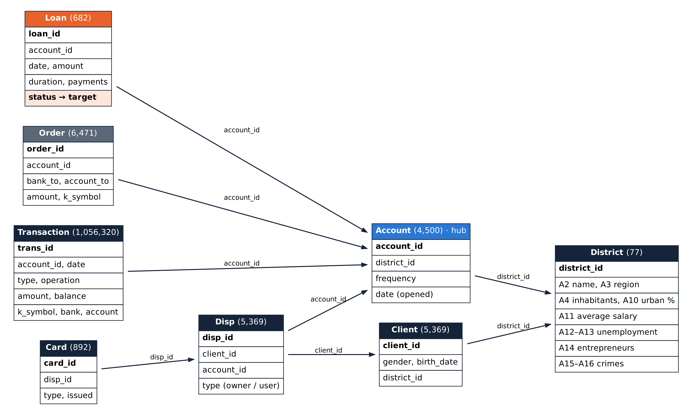
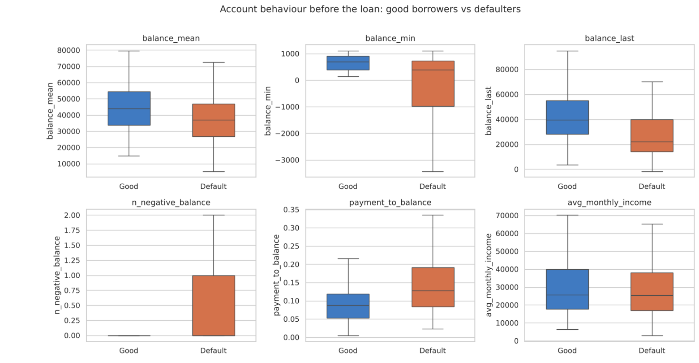
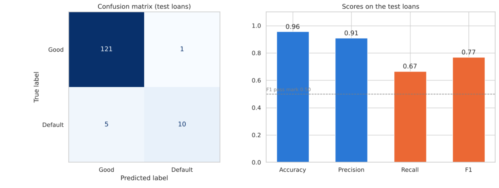
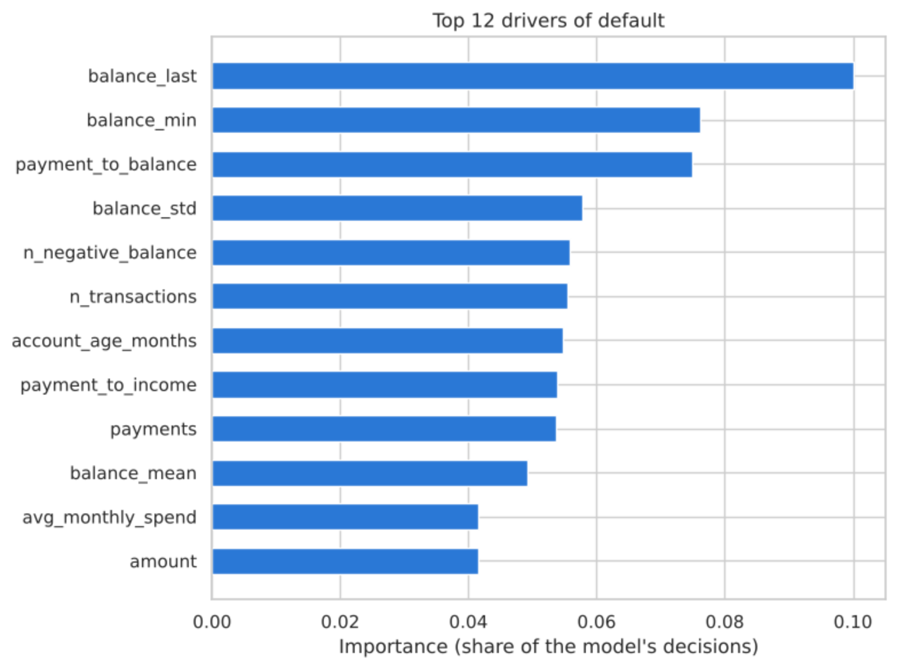
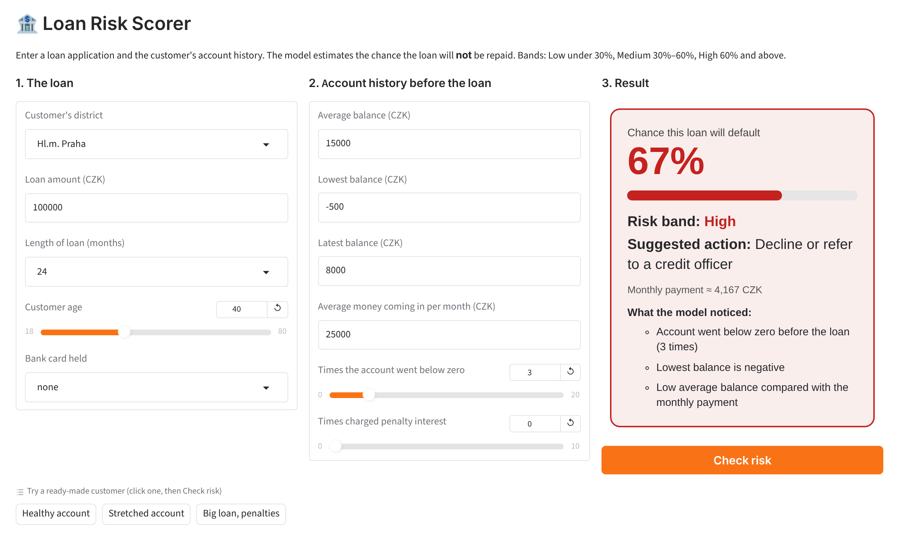

# Loan Default Prediction

Predicting, **before a loan is approved**, whether a bank customer is likely to default (not repay), using the bank's own data about accounts, transactions, cards and districts.

**NTUC Associate Data Analyst Capstone, Finance track** · Author: **Reshma** · October 2026

| | |
|---|---|
| **Data** | PKDD'99 Financial Database: a Czech bank, 1993–1998, 8 linked CSV files |
| **Final model** | Tuned Random Forest (250 trees) |
| **Main score** | **F1 = 0.77** on 137 unseen loans (pass mark 0.50) |
| **Other scores** | Precision 91% (10 of 11 warnings right) · Recall 67% (10 of 15 defaulters caught) · Accuracy 96% |
| **Tools** | Python, pandas, NumPy, Matplotlib, Seaborn, SciPy, scikit-learn, joblib, Gradio |

---

## 1. The problem

Banks lose money when borrowers don't repay. In this bank, **76 of 682 loans (about 1 in 9) defaulted**. The goal is to spot risky applicants before saying yes.

### Research objectives
| # | Objective | Answer |
|---|---|---|
| 1 | Clean the 8 tables and join them into one table, one row per loan | Done: 682 loans, none lost in any join |
| 2 | Is account behaviour before the loan linked to default? | Yes, strongly: all 27 accounts overdrawn before the loan defaulted |
| 3 | Are loan terms linked to default? | Yes: a payment large compared with the usual balance raises risk about 8× |
| 4 | Do customer and regional factors matter? | Much less; shared accounts never defaulted |
| 5 | Build and compare 5 models; reach F1 ≥ 0.50 on unseen loans | Random Forest, test F1 0.77 |
| 6 | Find the drivers and recommend actions | Pilot with a credit officer, monitor monthly |

## 2. Repository structure

```
loan-default-prediction/
├── Loan_Default_Prediction.ipynb   # main notebook: the whole project (sections 1-15)
├── Loan_Risk_Demo.ipynb            # opens the Loan Risk Scorer web app (live demo)
├── requirements.txt
├── data/                           # the 8 input files (Transaction.csv is zipped to fit GitHub)
│   ├── Account.csv  Card.csv  Client.csv  Disp.csv  District.csv  Loan.csv  Order.csv
│   └── Transaction.csv.zip
├── outputs/                        # results from a full run
│   ├── loan_default_model.joblib   # trained model
│   └── scored_applications.csv     # risk score + band for the 137 test loans
├── docs/                           # data dictionary, relationship diagram, presentation, full README guide
└── images/                         # pictures used in this README
```

## 3. How to run

**Google Colab (recommended)**
1. Download this repository (green **Code** button → **Download ZIP**) and unzip it.
2. Upload the folder to Google Drive (e.g. `My Drive/Capstone`).
3. Open `Loan_Default_Prediction.ipynb` with Google Colab → **Runtime → Run all** → allow Google Drive access.
4. The first cell prints `Loan.csv found: True`. The full run takes about 1–2 minutes.
5. For the demo, open `Loan_Risk_Demo.ipynb` → **Run all** → click the `gradio.live` link.

**Own computer**
```bash
pip install -r requirements.txt
jupyter notebook Loan_Default_Prediction.ipynb
```
The notebook reads `Transaction.csv.zip` directly, so there is no need to unzip it. All random steps use `RANDOM_STATE = 42`, so results are the same on every run.

## 4. The data

| File | One row is | Rows | Used for |
|---|---|---|---|
| Loan | a loan, with its status (the target) | 682 | Amount, length, monthly payment |
| Account | a bank account | 4,500 | Account age, statement frequency |
| Transaction | one money movement | 1,056,320 | Balances, income, overdrafts, penalties |
| Disp | a person's role on an account | 5,369 | Owner, number of users |
| Client | a customer | 5,369 | Age |
| Card | a payment card | 892 | Card held before the loan |
| District | a region | 77 | Salary, unemployment, crime |
| Order | a standing payment order | 6,471 | Not used in the model (no dates) |

**Target:** loan status A (finished, paid) and C (running, OK) = good; **B (finished, not paid) and D (running, in debt) = default**.



## 5. Method (what the notebook does)

1. **Clean:** dates to real dates, Czech codes to English, blank/empty purpose codes to "unknown", one district's missing 1995 figures filled with 1996 values, signed transaction amounts. Every fix is written to a cleaning log.
2. **Check:** unique IDs, every loan's account exists, one owner per account, amount = months × payment.
3. **Join:** start from the 682 loans and left-join the other tables on shared IDs; the row count stays 682 after every join.
4. **No data leakage:** only transactions and cards from **before** each loan date are used; the Order table (no dates) is left out.
5. **Features:** 24 inputs per loan, e.g. average, lowest and latest balance, balance volatility, overdrafts, penalty interest, income, payment ÷ balance, age, district economics. Gender is excluded for fairness.
6. **Explore:** box plots, default rates by group, correlation, Mann-Whitney U and Chi-square tests (11 of 26 inputs significant).
7. **Model:** 80/20 stratified split (545 / 137 loans), 5 models compared with 5-fold cross-validation, Random Forest tuned on F1 with `RandomizedSearchCV`.
8. **Test** once on the 137 hidden loans, then check feature importance, a shuffled-label sanity check and a later-years test.
9. **Deploy:** saved model, scoring function, risk bands, batch CSV report, Gradio web app and API.
10. **Scale and monitor:** speed test, retraining on new data, PSI drift and yearly F1 checks.



## 6. Results

**Cross-validation on 545 training loans**

| Model | Accuracy | Precision | Recall | F1 |
|---|---|---|---|---|
| **Random Forest** | 90.6% | 61.1% | 50.8% | **0.541** |
| Gradient Boosting | 92.1% | 76.7% | 40.9% | 0.528 |
| Logistic Regression | 81.1% | 34.8% | 72.3% | 0.464 |
| Decision Tree | 76.9% | 27.7% | 58.8% | 0.364 |
| Baseline (always "good") | 88.8% | 0% | 0% | 0.000 |

**Final test on 137 unseen loans (tuned Random Forest)**

| | Model said Good | Model said Default |
|---|---|---|
| Really good (122) | 121 | 1 |
| Really defaulted (15) | 5 | **10** |

F1 = 2 × precision × recall ÷ (precision + recall) = 2 × 0.91 × 0.67 ÷ (0.91 + 0.67) = **0.77**



**Why F1 and not accuracy?** Only 11% of loans defaulted, so a model that always says "will repay" is 89% accurate but catches nobody (F1 = 0).

**Reliability:** shuffled answers drop F1 from 0.56 to 0.02; trained on 1993–96, the model scores F1 0.65 on 1997–98 loans.

**Risk bands on the test loans:** Low (< 30%): 112 loans, 1% defaulted · Medium (30–60%): 16 loans, 31% · High (≥ 60%): 9 loans, 100%.



## 7. Live demo

The **Loan Risk Scorer** (Gradio) takes a loan application and account history and returns the chance of default, a risk band, a suggested action and the warning signs it noticed.



## 8. Recommendations

1. Pilot the model: score every application; a credit officer reviews High and Medium flags.
2. Treat overdrafts and low balances before a loan as early warning signs.
3. Add dates to standing orders so they can be used safely.
4. Monitor monthly (PSI, F1, default rate) and retrain when an alert fires.
5. Keep gender out of credit decisions and check outcomes are fair.
6. Use the simple Logistic Regression scorecard to explain decisions.

## 9. Limitations

Small dataset (682 loans, 76 defaults), old data (1990s) from one bank, and a small test set (15 defaulters). The cross-validation F1 (0.56) is the cautious estimate.

---

*Data source: PKDD'99 Discovery Challenge Financial Dataset (anonymised Czech bank data), provided as part of the NTUC capstone. A detailed, section-by-section explanation of the code is in [docs/README_full_guide.docx](docs/README_full_guide.docx).*
